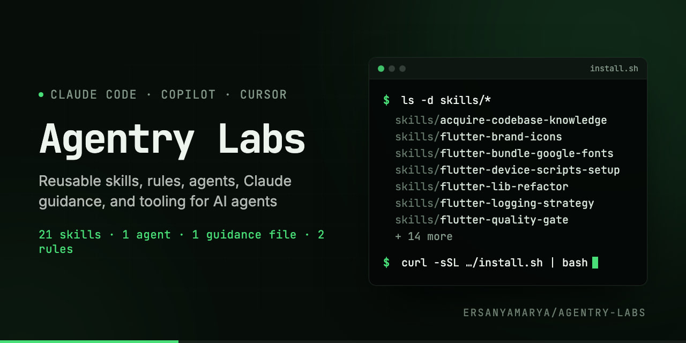

# Agentry Labs



Reusable skills, rules, agents, Claude guidance, and tooling for AI agents

## What is Agentry Labs?

A collection of framework-agnostic AI agent components — Claude Code skills and guidance files, GitHub Copilot agents, Cursor rules, and MCP configs. Designed for reuse across projects.

## Requirements

- Bash and Git. The installer clones this repo from GitHub unless `--source` points at a local checkout.
- Node.js for the `.mjs` scripts in `scripts/`.

## Getting started

### One-line Installer
```bash
curl -sSL https://raw.githubusercontent.com/ersanyamarya/agentry-labs/main/scripts/install.sh | bash
```

By default, the installer writes to `./.claude` in the current project. Pass
`--global` to write to `~/.claude` instead. The installer opens a chooser when
run in an interactive terminal; select a whole component type, an individual
component, or everything:

```bash
# See every available selector
./scripts/install.sh --list

# Install every skill and rule
./scripts/install.sh --type skills --type rules

# Install only one skill
./scripts/install.sh skills/run-fallow

# Install one skill globally
./scripts/install.sh --global skills/run-fallow

# Mix component types and individual components
./scripts/install.sh skills/run-fallow rules agents/super-planner.agent.md

# Install the basic Claude project guidance template
./scripts/install.sh claude-md-files/BASIC_CLAUDE.md

# Install everything into a custom agent directory
./scripts/install.sh --all --target "$HOME/.config/my-agent"

# Select components through the one-line installer
curl -sSL https://raw.githubusercontent.com/ersanyamarya/agentry-labs/main/scripts/install.sh | bash -s -- skills/run-fallow

# Install globally through the one-line installer
curl -sSL https://raw.githubusercontent.com/ersanyamarya/agentry-labs/main/scripts/install.sh | bash -s -- --global skills/run-fallow
```

Run `./scripts/install.sh --help` for all selectors, options, and examples.

### Manual Copy
1. Clone this repo
2. Copy skills to the current project's Claude Code directory:
   ```bash
   mkdir -p .claude/skills
   cp -r skills/* .claude/skills/
   ```

### Bundles and syncing

`bundles.tsv` tags each component `global`, `flutter`, `mongodb` or `web`. Install a bundle, or re-run the same command to sync it:

```bash
# Global bundle into ~/.claude (from a local checkout; omit --source to clone from GitHub)
./scripts/install.sh --source . --global --bundle global

# Flutter skills into the current project
./scripts/install.sh --source /path/to/agentry-labs --bundle flutter

# See what would change without writing
./scripts/install.sh --source . --bundle flutter --dry-run
```

Global settings, hooks and MCP servers live in `global/`. Preview the merge into `~/.claude`, then apply it:

```bash
node scripts/apply-global.mjs          # prints the plan
node scripts/apply-global.mjs --write  # applies it and saves backups
```

The merge also installs `global/hooks/prefer-trail.mjs` into `~/.claude/hooks`. In a repo indexed by trail (a `graft/` or `.trail/` folder) it denies `grep`, `rg`, `find`, `cat`, `head`, `tail`, `Grep`, `Glob` and a first whole-file `Read` of source, and names the trail tool to use. End a Bash command with `# no-trail: <why>` to run it anyway (logged to `~/.claude/trail-bypass.log`); `PREFER_TRAIL=off` disables it.

The context7 MCP entry reads `CONTEXT7_API_KEY` from your shell environment (export it from your shell profile; the desktop app does not read shell rc files). Compare skill copies across projects with `node scripts/skill-drift.mjs`.

### Skill shelf

Every installed skill puts its name and description in every session, and past the listing budget Claude Code drops
descriptions, so rarely used skills crowd out the useful ones. Rarely used groups live in `~/.claude/skill-shelf/<group>/`
instead (currently `video`, `audit`, `flutter-assets`, `design`, `web-audit`, `dev-tools`) and are symlinked in when
needed. The shelved skills (`image-artifact-setup`, `lighthouse-audit`, and four flutter-assets skills) are in no bundle, so
installs never copy them back. Turn them on with `agentry shelf on <group>`:

```bash
agentry shelf list                        # groups, the description tokens each costs when on, and where each is on
agentry shelf status [--json]             # what is on in this project and globally, plus broken links
agentry shelf on video audit/review       # several targets at once: a group, group/skill, or a skill name unique across groups
agentry shelf on video --global           # ~/.claude/skills, every project (default: this project's .claude)
agentry shelf off video                   # remove those links
agentry shelf off --all                   # remove every shelf link in this project (add --global for ~/.claude)
agentry shelf on audit --dry-run          # print the links and exclude lines it would change; write nothing
agentry shelf shelve pdf docs             # move ~/.claude/skills/pdf onto the shelf as group docs
agentry shelf unshelve pdf                # move it back to ~/.claude/skills
agentry shelf promote my-skill            # move this project's .claude/skills/my-skill to ~/.claude/skills (every project)
agentry shelf demote my-skill             # the reverse: ~/.claude/skills/my-skill into this project (add --dry-run to preview)
agentry shelf remove docs/pdf             # delete it; a copy is kept in ~/.claude/backups/agentry/removed/<time>/
agentry shelf remove docs/pdf --no-backup # delete it and keep no copy (add --dry-run to see which it would be)
agentry backups list [--json]             # fix backup sets, removed-skill and updated copies, with size and age
agentry backups restore <id> [--dry-run]  # move a removed skill or an updated copy back where it came from; never overwrites
agentry backups prune --older-than 30 --kind removed --dry-run   # or --all; --kind fix|removed|updated; previewed, then asked (--yes for scripts)
agentry backups delete <id>... [--yes]    # delete chosen backups; a fix set not yet undone can then not be undone
agentry scan ~/ws --find-skill pdf        # every repo/worktree with .claude/skills/pdf, git-tracked ones marked; --global adds ~/.claude/skills (--remove-skill keeps a copy unless --no-backup)
agentry scan ~/ws --remove-skill pdf --dry-run   # delete that folder from each (no copy; shelf links are skipped)
agentry catalog refresh                   # fetch the agentry-labs skill catalog (shallow git clone, cached)
agentry catalog list [--json]             # skills, agents, rules, CLAUDE.md files and MCP servers (kind/name), where each is installed, "outdated" when it differs
agentry catalog add run-fallow --group dev # a skill goes onto the shelf (off); never overwrites
agentry catalog add agent/super-planner [--project]   # agent -> ~/.claude/agents (or .claude/agents)
agentry catalog add rule/context7          # rule -> ~/.claude/rules
agentry catalog add claude-md/BASIC_CLAUDE # -> ./CLAUDE.md, refused when the project has one
agentry catalog add mcp/trail --project --dry-run   # through `mcp add`: masked preview, backup, undo (--yes to apply)
agentry catalog update --all --dry-run     # or <item>...; lists every file it overwrites, saves the old copy under backups/updated/, asks (--yes for scripts)
agentry catalog remove agent/super-planner [--project]   # delete an installed agent; a copy is kept under backups/removed/ (--no-backup, --dry-run, --yes)
agentry rules list [--json]                # CLAUDE.md and rule files loaded here, with tokens
agentry rules remove CLAUDE.md [--dry-run] [--no-backup]   # delete one; a copy is kept in the backups
```

`list` estimates each group's cost as the frontmatter `description` of its skills and agents, at about four characters
per token: what the group adds to every session once it is on. Project links are listed in `.git/info/exclude` (the
shared one in a worktree), so they never show as untracked. `shelve` refuses to overwrite a folder, and both `shelve`
and `unshelve` refuse while a link to the skill exists; run `off` first.

A group's agents sit in `~/.claude/skill-shelf/<group>/agents/*.md` (the `audit` group carries `slop-auditor-analyst`) and
are linked into `.claude/agents` with its skills. Claude Code watches skill folders, so a running session picks skills up;
start a new session if a linked agent doesn't show. To shelve another group, move its skill folders (and agents) into a new
`~/.claude/skill-shelf/<group>/`. Leave `~/.claude/skills/synced/` alone: claude.ai manages it.

### agentry CLI

`agentry` runs from any folder. It needs Node.js 22 or newer. Install the checkout's dependencies once (Ink and React for `agentry ui`), then link it:

```bash
cd /path/to/agentry-labs
npm install                    # once: Ink and React for `agentry ui`
npm link                       # puts `agentry` on your PATH (or: npm install -g /path/to/agentry-labs)

agentry --help                 # commands and options
agentry shelf list             # shelf groups, their token cost and whether each is on
agentry shelf on video         # also: off <group>, off --all, shelve, unshelve; --global for ~/.claude, --dry-run to preview
agentry mcp disable context7   # park a user-scope MCP server (also: enable, list-parked; --dry-run, --yes); undo with agentry fix --undo
agentry mcp disable plugin:context-mode:context-mode   # plugin, project (.mcp.json) and local servers: off for this project only (disabledMcpServers)
agentry mcp add files --command npx --arg=-y --arg @scope/files --env FILES_TOKEN=abc   # add a server (--url U --header K:V for http; --scope user|project; --dry-run, --yes)
agentry mcp set files --env FILES_TOKEN=new   # change env/args of a user server (--unset-env K, --arg=A replaces args); backed up, undoable
agentry hook list              # every hook with an 8-hex id; then: hook disable|enable|remove <id> [--scope S] [--dry-run] [--yes]
agentry plugin install demo@market --scope project   # claude plugin install through the preview/backup path; also: uninstall demo
agentry plugin disable demo    # also: enable; --scope user|project|local, --dry-run, --yes; backed up, undo with agentry fix --undo; refuses a plugin set by macOS MDM (names the source)
agentry ui                     # terminal UI (Ink); a bare `agentry` in a terminal opens it too
```

`agentry --help` loads no UI code, so it works even before `npm install`. Run tests with `npm test`.

#### agentry ui

`agentry ui` is a keyboard-driven view of the project you run it in: what loads, what it costs, what is wrong.

Start it from the project folder with `agentry ui`, or type a bare `agentry` in a terminal. It needs a terminal: without one it prints a message and exits `2`. The `p` picker switches to another repo (current repo, recent repos, then repos under the scan roots).

- **Tabs:** Skills, MCP, Hooks, Plugins, Doctor, Catalog, Backups, Rules, each with a count where the width allows (below about 120 columns only the first few show one). A summary line under them shows the skill-description tokens every session pays and the problems found. A details pane beside the list shows the selected row; the footer lists only the keys that work on the current tab.
- **Copying:** on any preview or result, `c` copies its text (refusals and errors included) to the system clipboard (`pbcopy`, `clip`, `wl-copy` or `xclip`; otherwise the terminal's OSC 52 escape).
- **Changes it can make** (all except the plain shelf toggle are previewed first and wait for `y`):
  - **Skills, shelf:** Each shelf row has two columns, **Project** (this project) and **Global**, each `● on`, `○ off` or `◐ partial`. `space` toggles the Project column of the selected row and `g` toggles the Global column; there is no mode to switch. Same as `agentry shelf on|off [--global]`.
  - **Skills, shelving:** `s` on a global skill (a real folder under `~/.claude/skills`) asks for a shelf group (`↑/↓` and `enter`, or `n` to type a new name), previews the move, and `y` runs `agentry shelf shelve`. Afterwards the skill sits under Shelf, off, and toggles with `space`. `u` on a shelved skill moves it back (`agentry shelf unshelve`). Both refuse to overwrite, and to move a skill that is still linked.
  - **Skills, scope moves:** `a` on a project-only skill (This project only) previews moving the folder to `~/.claude/skills` so every project loads it; `o` on a global skill folder previews moving it into this project only. `y` moves it (no copy kept); both refuse links and never overwrite. Same as `agentry shelf promote|demote <skill>`.
  - **Plugins, install:** `i` on the Plugins tab asks for `name@marketplace` (the marketplace must already be added to claude), then a scope, previews the `claude plugin install` command and the settings file it backs up; `x` previews `claude plugin uninstall` (a scope pick when it is installed at several). Same as `agentry plugin install|uninstall`. `fix --undo` restores the settings file only; the cache and `installed_plugins.json` stay as claude left them.
  - **Plugins:** `space` on a plugin row (Plugins tab) or a `plugin:*` row (Skills tab) previews the `enabledPlugins` edit as a diff; `y` writes it with a backup. Same as `agentry plugin enable|disable`, and `agentry fix --undo` restores it. It applies to new sessions only.
  - **Doctor:** `enter` previews a fix as a diff. `y` applies it through the same engine as the CLI, with a backup first. `u` previews undoing the last fix set, and `y` restores it.
  - **MCP:** `space` on a user-scope server previews turning it off (its config is saved, then `claude mcp remove --scope user` runs, with a backup of `~/.claude.json`); turned-off servers stay in the list as `○ off`, and `space` adds them back with `claude mcp add-json`. Same as `agentry mcp disable|enable <name>`, `agentry mcp list-parked`. The saved configs live in `~/.claude/agentry/parked-mcp.json` (mode 0600), with their secrets, exactly as exposed as `~/.claude.json`. Plugin, project `.mcp.json` and desktop servers say who manages them instead.
  - **MCP, add and edit:** `a` opens an add form (name, command or url, env or headers, user or project scope) ending in a masked preview; `y` runs `claude mcp add-json` (user) or edits `.mcp.json` (project). Typed env and header values show as `****`. `s` on a user server edits its env (`KEY=VALUE` sets, `-KEY` removes) and args (replaces them), as a text edit of `~/.claude.json`. Same as `agentry mcp add|set`; the form splits on spaces, so arguments with spaces need the CLI.
  - **Hooks:** `space` on a hook from user, project or local settings previews turning it off: the entry moves out of the settings file into `~/.claude/agentry/parked-hooks.json` (mode 0600, raw command, so as sensitive as the settings file) and shows as `○ off`; `space` again puts it back in the same event and matcher group. `x` deletes it. Plugin hooks say the plugin manages them. Backed up, undo with `agentry fix --undo`; same as `agentry hook disable|enable|remove <id>` (ids come from `agentry hook list`: a hash of event, matcher and command).
  - **Skills, removing:** `x` on a shelved skill, a global skill folder or a project-only skill folder (`agentry shelf remove <skill> --project` on the CLI) previews the delete, saying whether a copy is kept; `y` copies the folder to `~/.claude/backups/agentry/removed/<time>/` and removes it (same as `agentry shelf remove`). `X` does the same but keeps no copy (`--no-backup`). It refuses while the skill is linked into a project.
  - **Backups:** the tab lists the fix sets, removed-skill copies and updated copies with size and age. `u` previews moving a removed skill or an updated copy back (it never overwrites), `x` previews deleting the selected backup, `d` previews deleting every backup 30 or more days old; `y` applies, `c` copies the preview. Same as `agentry backups restore|delete|prune`. Deleting a fix set that is not undone yet ends `agentry fix --undo` for it, and the preview says so.
  - **Catalog:** `f` fetches the agentry-labs repo (a shallow git clone under `~/.claude/cache/agentry/catalog`; the only network use), then the tab lists its skills by bundle, then agents, rules, CLAUDE.md files and MCP servers, with where each is installed. `i` previews and `y` installs the selected item: a skill onto the shelf under its bundle name (off; turn it on from the Skills tab), an agent into `~/.claude/agents`, a rule into `~/.claude/rules`, a CLAUDE.md file as the project's `CLAUDE.md` (refused when it has one), an MCP server through the MCP add path (masked preview, backup, undo). `o` does the same for an agent or MCP server in this project only. `outdated` marks an installed skill, agent, rule or CLAUDE.md file whose files differ from the cached clone, and an MCP server whose catalog entry differs from yours; `u` previews each file it would overwrite or add (files only in your copy are kept) and `y` replaces them after saving the current copy under `~/.claude/backups/agentry/updated/`. Without a local edit you cannot tell an upstream change from your own edit, so the preview says every overwritten file loses local changes. `x` removes an installed skill, agent or rule (a copy goes to the backups). Same as `agentry catalog`.
  - **Rules:** the CLAUDE.md and rule files Claude Code loads every session: `~/.claude/CLAUDE.md`, `~/.claude/rules/**/*.md`, the project's `CLAUDE.md`, `.claude/CLAUDE.md`, `CLAUDE.local.md` and `.claude/rules/**/*.md`, with the token cost of the whole file. `e` opens one; `x` previews removing it (a copy goes to the backups, so the Backups tab restores it) and `y` confirms; `X` keeps no copy. Same as `agentry rules`.
- **Rows that cannot be toggled** say why in the status line and the details: global skills ("press s to move it onto the shelf"), project skills ("files live in the repo") and symlinked or broken skills.
- **Hooks** list what loads and its source file, with secrets masked. `e` opens a source file in `$EDITOR`.

Colour (off when `NO_COLOR` is set; every badge has a symbol and a word, so nothing depends on it): `● on` / `● active` green, `○ off` / `○ disabled` gray, `◐ partial` yellow; token cost dim under 100, yellow under 500, red from 500 (legend line on the Skills tab); scope tags `global` cyan, `project` magenta, `plugin` blue, `shelf` yellow; Doctor `✖` error red, `▲` warning yellow, `ℹ` info blue; the selected row is inverse with a `>`.

| Key | Action |
|---|---|
| ← / →, 1-8 | switch tab |
| ↑ / ↓ | move between rows |
| enter | details, expand a group, preview a fix |
| space | Skills: shelf row on/off for this project; plugin rows: on/off; MCP, Hooks: turn off (saved) / add back |
| a | MCP: add a server (user or project scope) |
| g | Skills: shelf row on/off globally |
| s | Skills: move a global skill onto the shelf; MCP: edit env/args of a user server |
| a | Skills: move a project-only skill to ~/.claude/skills (all projects) |
| o | Skills: move a global skill into this project only; Catalog: add an agent or MCP server to this project only |
| u | Skills: unshelve a skill; Doctor: undo the last fix set; Backups: restore a removed skill or updated copy; Catalog: update an outdated item (skill, agent, rule, CLAUDE.md, MCP server) |
| x | Skills: remove a skill; Catalog: remove an installed skill, agent or rule (a copy is kept in the backups); Rules: remove a file; Backups: delete a backup; MCP, Hooks: remove; Plugins: uninstall |
| X | Skills, Catalog, Rules: remove and keep no copy |
| d | Backups: delete the backups 30+ days old |
| i | Catalog: add the selected skill (to the shelf, off), agent, rule, CLAUDE.md or MCP server; Plugins: install a plugin |
| f | Catalog: fetch or update the agentry-labs catalog |
| / | search the rows of the current tab: type, enter keeps it, esc clears it (q and tab keys are text while typing) |
| m / M | mark or unmark the selected row / clear marks; space, g, x, X, i, u then apply to all marked rows, one preview, one y |
| e | open the selected row's file in $EDITOR |
| y / n | confirm or cancel a previewed change; c copies the preview |
| r | refresh |
| p | switch project |
| ? | this help |
| q | quit |

Press `?` in the UI to see the same table. Layout: from 110 columns the details sit in a box beside the list; below that they go under the list so the list keeps the whole width and its Project/Global badges are never cut (a long name is shortened with `…` in the middle instead). The summary line shortens to fit, and the footer lists only the keys that work on the selected row, in one line. `/` filters the rows of any tab; `m` marks rows (shown with `*`, counted under the list) so one space or `x` previews and applies to all of them at once. The last Skills row, Token total, breaks the description tokens down into global, this project and plugins. Screenshot below is a plain-text capture of the Skills tab at 100 columns, with two shelf groups marked (colours are lost in text; not an image), with the home folder shown as `~`:

```text
agentry  ~/ws/aryantriki/agentry-labs
 1 Skills (24)   2 MCP (4)   3 Hooks   4 Plugins   5 Doctor   6 Catalog (28)   7 Backups   8 Rules
~1023 skill-description tokens  ·  plugins 2 ● active 3 ○ disabled  ·  no problems
● on ○ off ◐ partial  cost: ~<100 ~100-499 ~500+
 Shelf                                                   Skills      Cost  Project      Global
*▸ audit                                                 7 skills   ~1078  ○ off        ○ off
>▸ design                                                2 skills    ~296  ○ off        ○ off
 ▸ dev-tools                                             1 skills    ~103  ○ off        ○ off
 ▸ flutter-assets                                        4 skills    ~606  ○ off        ○ off
 ▸ general                                               0 skills      ~0  ○ off        ○ off
 ▸ video                                                 28 skills  ~3001  ○ off        ○ off
 ▸ web-audit                                             1 skills    ~135  ○ off        ○ off

Global skills ──────────────────────────
   humanize-and-unslop                                                ~44               ● active
   run-fallow                                                        ~158               ● active
  3/27
 2 marked (space/x apply to all, M clears)

────────────────────────────────────────────────────────────────────────────────────────────────────
Details
shelf group: design (opt-in)
this project: ○ off
global: ○ off
contains: 2 skills
cost when on: ~296 tokens
toggle: space = this project, g = global; enter expands
space project  g global  enter expand  │ ←→ tabs  ? help  q quit
```

## Commands
1. Install skills
2. Invoke a skill by name in Claude Code, interactively or with `-p`. Skills also trigger on their own when a request matches their description.
   ```bash
   claude -p "/run-fallow"
   claude -p "/humanize-and-unslop README.md --detect"
   ```

## Project layout

- `skills/`: Claude Code skills, one folder each
- `agents/`: agent definitions
- `rules/`: commit-attribution and context7 rules
- `claude-md-files/`: reusable CLAUDE.md templates
- `global/`: settings fragment and MCP config merged by `scripts/apply-global.mjs`, plus `hooks/` scripts it copies to `~/.claude/hooks`
- `scripts/`: installer, global-settings merge, skill drift check and the README cover generator
- `bin/`: the `agentry` command entry and router
- `lib/`: the CLI modules (paths, shelf, catalog, status, doctor, scan, fix, tokens, inventory)
- `tui/`: the Ink terminal UI behind `agentry ui`
- `docs/`: design plans, such as `cli/docs/shelf-cli-plan.md`
- `test/`: tests for the CLI (`npm test`)
- `bundles.tsv`: the bundle each component belongs to

## Available Components

### Skills (`.claude/skills/`)

**`global`** (any project; install once into `~/.claude`):

| Skill | Description |
|-------|-------------|
| `agentry` | Answer "what loads here", slow-session and duplicate MCP or skill questions from `agentry status`, `doctor` and `scan --json`; fixes go through `agentry fix`. |
| `generate-commit-message` | Write a Conventional Commit message in this repo's style (type(scope): Capitalized summary) from staged or unstaged changes. |
| `humanize-and-unslop` | Edit drafts into plain, specific, human-sounding writing by removing AI tells (banned vocabulary, em dashes, curly quotes, puffery, chatbot phrases, formulaic structures) |
| `phased-plan` | Write a phased implementation plan where every phase delivers testable value and each task names the cheapest Claude model that does it, run inline on Sonnet or as a subagent on Haiku or Opus |
| `run-fallow` | Run the `fallow` CLI on any JavaScript/TypeScript project to find dead code, unused dependencies, duplication, complexity hotspots, and security candidates, then report c |
| `skill-architect` | Create, improve, or review Claude Code skills so they are portable, token-efficient, and spec-compliant, with scripts doing the exact work and the model doing the judgmen |
| `sync-docs-from-diff` | Update repo documentation from a git diff. |
| `write-project-readme` | Draft or refresh a project README from Product.md, Brand.md, and the repository structure. |

**`flutter`** (Flutter and Dart projects):

| Skill | Description |
|-------|-------------|
| `acquire-codebase-knowledge` | Use this skill when the user explicitly asks to map, document, or onboard into an existing Flutter/Dart codebase. |
| `flutter-lib-refactor` | Audit and refactor a Flutter project's lib/ folder into a feature-first layered architecture. |
| `flutter-logging-strategy` | Establish, audit, and enforce a consistent logging strategy in any Flutter/Dart project using package:logging — installs the dependency if missing, builds a named-logger  |
| `flutter-quality-gate` | Run the Flutter quality checks (format, analyze, test) for a Flutter app and fix common issues. |
| `theme-hardcoding-audit` | Audit the app for hardcoded theme values, local styling drift, and visual inconsistencies. |

**`mongodb`** (MongoDB / Mongoose projects):

| Skill | Description |
|-------|-------------|
| `mongodb-data-modeling` | Design new MongoDB/Mongoose schemas or audit existing ones against document-modeling best practices — embedding vs. referencing, unbounded arrays, compound index field or |
| `mongoose-schema-docs` | Generate documentation and an entity-relationship diagram from a codebase's Mongoose schemas. |

**`web`** (web UI projects):

| Skill | Description |
|-------|-------------|
| `shadcn` | Manages shadcn components and projects — adding, searching, fixing, debugging, styling, and composing UI, including chat interfaces. |

Shelved skills (`image-artifact-setup`, `lighthouse-audit`, `flutter-brand-icons`, `flutter-bundle-google-fonts`, `flutter-device-scripts-setup`, `flutter-store-assets`) are in no bundle; they live on the shelf (`agentry shelf on <group>`, see [Skill shelf](#skill-shelf)).

Skills tied to gentlemans-stack layers, generators and libs (Nx workspace and package linking, `api-endpoints`, `service-handler-tests`, `domain-repository-tests` and similar) live in that repo's `.claude/skills` and reach projects through its sync, not from here.

### Agents (`.claude/agents/`)
| Agent | Description |
|-------|-------------|
| `super-planner` | Investigate a task and produce a verified, execution-ready plan without making changes |

### Rules (`.claude/rules/`)
| Rule | Description |
|------|-------------|
| `commit-attribution` | No AI attribution lines in commits or pull requests |
| `context7` | When and how to fetch current library docs with the Context7 MCP |

### Claude MD files (`.claude/claude-md-files/`)
| File | Description |
|------|-------------|
| `BASIC_CLAUDE.md` | Starting template for concise project-specific Claude Code guidance |

## Adding New Components
1. Fork this repo
2. Add your component to the appropriate directory
3. Submit a PR

## License
MIT