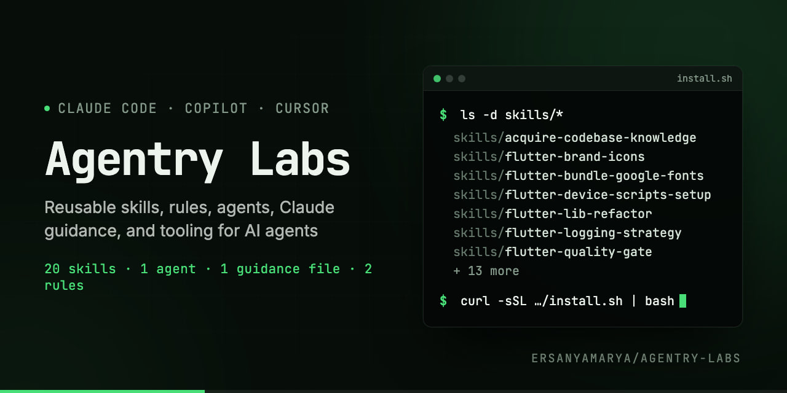

# Agentry Labs



Reusable skills, rules, agents, Claude guidance, and tooling for AI agents

## What is Agentry Labs?

A collection of framework-agnostic AI agent components — Claude Code skills and guidance files, GitHub Copilot agents, Cursor rules, and MCP configs. Designed for reuse across projects.

## Requirements

- Bash and Git. The installer clones this repo from GitHub unless `--source` points at a local checkout.
- Node.js for the `.mjs` scripts in `scripts/`.

## Getting started

### One-line Installer
```bash
curl -sSL https://raw.githubusercontent.com/ersanyamarya/agentry-labs/main/scripts/install.sh | bash
```

By default, the installer writes to `./.claude` in the current project. Pass
`--global` to write to `~/.claude` instead. The installer opens a chooser when
run in an interactive terminal; select a whole component type, an individual
component, or everything:

```bash
# See every available selector
./scripts/install.sh --list

# Install every skill and rule
./scripts/install.sh --type skills --type rules

# Install only one skill
./scripts/install.sh skills/run-fallow

# Install one skill globally
./scripts/install.sh --global skills/run-fallow

# Mix component types and individual components
./scripts/install.sh skills/run-fallow rules agents/super-planner.agent.md

# Install the basic Claude project guidance template
./scripts/install.sh claude-md-files/BASIC_CLAUDE.md

# Install everything into a custom agent directory
./scripts/install.sh --all --target "$HOME/.config/my-agent"

# Select components through the one-line installer
curl -sSL https://raw.githubusercontent.com/ersanyamarya/agentry-labs/main/scripts/install.sh | bash -s -- skills/run-fallow

# Install globally through the one-line installer
curl -sSL https://raw.githubusercontent.com/ersanyamarya/agentry-labs/main/scripts/install.sh | bash -s -- --global skills/run-fallow
```

Run `./scripts/install.sh --help` for all selectors, options, and examples.

### Manual Copy
1. Clone this repo
2. Copy skills to the current project's Claude Code directory:
   ```bash
   mkdir -p .claude/skills
   cp -r skills/* .claude/skills/
   ```

### Bundles and syncing

`bundles.tsv` tags each component `global`, `flutter`, `mongodb` or `web`. Install a bundle, or re-run the same command to sync it:

```bash
# Global bundle into ~/.claude (from a local checkout; omit --source to clone from GitHub)
./scripts/install.sh --source . --global --bundle global

# Flutter skills into the current project
./scripts/install.sh --source /path/to/agentry-labs --bundle flutter

# See what would change without writing
./scripts/install.sh --source . --bundle flutter --dry-run
```

Global settings, hooks and MCP servers live in `global/`. Preview the merge into `~/.claude`, then apply it:

```bash
node scripts/apply-global.mjs          # prints the plan
node scripts/apply-global.mjs --write  # applies it and saves backups
```

The context7 MCP entry reads `CONTEXT7_API_KEY` from your shell environment (export it in `~/.zshenv`; the desktop app never reads `~/.zshrc`). Compare skill copies across projects with `node scripts/skill-drift.mjs`.

### Skill shelf

Every installed skill puts its name and description in every session, and past the listing budget Claude Code drops
descriptions, so rarely used skills crowd out the useful ones. Rarely used groups live in `~/.claude/skill-shelf/<group>/`
instead (currently `video`, `audit`, `flutter-assets`) and are symlinked in when needed:

```bash
node scripts/shelf.mjs list                       # groups, their skills, and where each is on
node scripts/shelf.mjs on video                   # this project's .claude/skills (kept out of git via .git/info/exclude)
node scripts/shelf.mjs on video --global          # ~/.claude/skills, every project
node scripts/shelf.mjs off video [--global]
```

A group's agents sit in `~/.claude/skill-shelf/<group>/agents/*.md` (the `audit` group carries `slop-auditor-analyst`) and
are linked into `.claude/agents` with its skills. Claude Code watches skill folders, so a running session picks skills up;
start a new session if a linked agent doesn't show. To shelve another group, move its skill folders (and agents) into a new
`~/.claude/skill-shelf/<group>/`. Leave `~/.claude/skills/synced/` alone: claude.ai manages it.

## Commands
1. Install skills
2. Invoke a skill by name in Claude Code, interactively or with `-p`. Skills also trigger on their own when a request matches their description.
   ```bash
   claude -p "/run-fallow"
   claude -p "/humanize-and-unslop README.md --detect"
   ```

## Project layout

- `skills/`: Claude Code skills, one folder each
- `agents/`: agent definitions
- `rules/`: commit-attribution and context7 rules
- `claude-md-files/`: reusable CLAUDE.md templates
- `global/`: settings fragment and MCP config merged by `scripts/apply-global.mjs`
- `scripts/`: installer, sync and shelf scripts
- `bundles.tsv`: the bundle each component belongs to

## Available Components

### Skills (`.claude/skills/`)

**`global`** (any project; install once into `~/.claude`):

| Skill | Description |
|-------|-------------|
| `generate-commit-message` | Write a Conventional Commit message in this repo's style (type(scope): Capitalized summary) from staged or unstaged changes. |
| `humanize-and-unslop` | Edit drafts into plain, specific, human-sounding writing by removing AI tells (banned vocabulary, em dashes, curly quotes, puffery, chatbot phrases, formulaic structures) |
| `image-artifact-setup` | Set up a reproducible image generator in a project (Open Graph and social cards, link previews, project or product tiles, README banners, store screenshots) by rendering  |
| `lighthouse-audit` | Run Google Lighthouse against a URL (mobile and desktop), trace the performance, accessibility, SEO, and best-practices findings to the project's actual source, and write |
| `run-fallow` | Run the `fallow` CLI on any JavaScript/TypeScript project to find dead code, unused dependencies, duplication, complexity hotspots, and security candidates, then report c |
| `skill-architect` | Create, improve, or review Claude Code skills so they are portable, token-efficient, and spec-compliant, with scripts doing the exact work and the model doing the judgmen |
| `sync-docs-from-diff` | Update repo documentation from a git diff. |
| `write-project-readme` | Draft or refresh a project README from Product.md, Brand.md, and the repository structure. |

**`flutter`** (Flutter and Dart projects):

| Skill | Description |
|-------|-------------|
| `acquire-codebase-knowledge` | Use this skill when the user explicitly asks to map, document, or onboard into an existing Flutter/Dart codebase. |
| `flutter-brand-icons` | Generate every app icon and native splash asset for a Flutter project from one single-color logo SVG, with colors taken from the project's brand doc, design doc, or Dart  |
| `flutter-bundle-google-fonts` | Replaces the google_fonts package in a Flutter project with fonts bundled in the app. |
| `flutter-device-scripts-setup` | Run the stack's scripts/flutter run-all and build-release: debug or release build installed on every connected Android phone, iPhone and this Mac. Wrapper only; the logic lives in the stack. |
| `flutter-lib-refactor` | Audit and refactor a Flutter project's lib/ folder into a feature-first layered architecture. |
| `flutter-logging-strategy` | Establish, audit, and enforce a consistent logging strategy in any Flutter/Dart project using package:logging — installs the dependency if missing, builds a named-logger  |
| `flutter-quality-gate` | Run the Flutter quality checks (format, analyze, test) for a Flutter app and fix common issues. |
| `flutter-store-assets` | Sets up and runs an image tool for a Flutter app that makes store screenshots (App Store iPhone and iPad, Mac App Store, Play phone and tablet), a Play feature graphic, s |
| `theme-hardcoding-audit` | Audit the app for hardcoded theme values, local styling drift, and visual inconsistencies. |

**`mongodb`** (MongoDB / Mongoose projects):

| Skill | Description |
|-------|-------------|
| `mongodb-data-modeling` | Design new MongoDB/Mongoose schemas or audit existing ones against document-modeling best practices — embedding vs. referencing, unbounded arrays, compound index field or |
| `mongoose-schema-docs` | Generate documentation and an entity-relationship diagram from a codebase's Mongoose schemas. |

**`web`** (web UI projects):

| Skill | Description |
|-------|-------------|
| `shadcn` | Manages shadcn components and projects — adding, searching, fixing, debugging, styling, and composing UI, including chat interfaces. |

Skills tied to gentlemans-stack layers, generators and libs (Nx workspace and package linking, `api-endpoints`, `service-handler-tests`, `domain-repository-tests` and similar) live in that repo's `.claude/skills` and reach projects through its sync, not from here.

### Agents (`.claude/agents/`)
| Agent | Description |
|-------|-------------|
| `super-planner` | Investigate a task and produce a verified, execution-ready plan without making changes |

### Rules (`.claude/rules/`)
| Rule | Description |
|------|-------------|
| `commit-attribution` | No AI attribution lines in commits or pull requests |
| `context7` | When and how to fetch current library docs with the Context7 MCP |

### Claude MD files (`.claude/claude-md-files/`)
| File | Description |
|------|-------------|
| `BASIC_CLAUDE.md` | Starting template for concise project-specific Claude Code guidance |

## Adding New Components
1. Fork this repo
2. Add your component to the appropriate directory
3. Submit a PR

## License
MIT