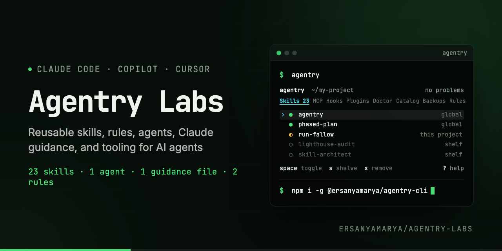

# Agentry Labs



Reusable skills, rules, Claude guidance, and tooling for AI agents

## What is Agentry Labs?

A collection of framework-agnostic AI agent components — Claude Code skills and guidance files, GitHub Copilot agents, Cursor rules, and MCP configs. Designed for reuse across projects.

## Install on any machine

One command installs the tools and wires them for Claude Code:

```bash
curl -sSL https://raw.githubusercontent.com/ersanyamarya/agentry-labs/main/scripts/setup.sh | bash
```

On a terminal it opens a menu. To skip the menu, pass arguments after `bash -s --`:

```bash
curl -sSL https://raw.githubusercontent.com/ersanyamarya/agentry-labs/main/scripts/setup.sh | bash -s -- install --all --yes
curl -sSL https://raw.githubusercontent.com/ersanyamarya/agentry-labs/main/scripts/setup.sh | bash -s -- status
curl -sSL https://raw.githubusercontent.com/ersanyamarya/agentry-labs/main/scripts/setup.sh | bash -s -- uninstall --all --yes
curl -sSL https://raw.githubusercontent.com/ersanyamarya/agentry-labs/main/scripts/setup.sh | bash -s -- install --only trail --dry-run
```

It installs five parts, each one optional (`--only <part>`):

| Part | What it does |
|---|---|
| `agentry` | The agentry CLI (npm `@ersanyamarya/agentry-cli`) |
| `trail` | The trail code-map CLI (npm `@trailhq/trail-code`), wired into Claude Code by its own `trail init` |
| `context-mode` | The context-mode CLI (npm `context-mode`), wired as a Claude Code plugin by its own `setup` |
| `copilot` | GitHub Copilot (CLI and VS Code), kept apart from Claude: `includeCoAuthoredBy: false`, the trail autobuild hook, the context7 MCP entry and the rules, all in `~/.copilot` (or `$COPILOT_HOME`). Runs only when the `copilot` CLI is on PATH and that folder exists |
| `config` | User-level rules, the settings fragment (trail env and hooks, and `attribution` so Claude adds no AI lines to commits or PRs), the trail autobuild hook and status line, and the context7 MCP entry |

Requirements: Node.js 24.15 or newer, plus Claude Code. Tools install at `@latest` with mise if it is on your PATH, else with `npm install -g`. Setup never installs mise or Node. It clones this repo into a temp folder and deletes it afterwards, records what it added in `<config>/agentry/install-manifest.json`, and backs up every file it changes. `uninstall` removes only what it recorded and keeps anything you edited. Use `--dry-run` to preview any command.

`--trust <dir>` (repeatable) adds a folder to Copilot's trusted folders, so the hooks in that repo's `.github/hooks` and `.claude/settings.json` run in Copilot. Setup never sets `COPILOT_ALLOW_ALL`, and adds no folder unless you name it.

### GitHub Copilot

Copilot reads, per repo, the project `CLAUDE.md`, `.claude/rules`, `.claude/skills`, `.claude/agents`, `.mcp.json` and the hooks in `.claude/settings.json`. It does not read anything under `~/.claude`. The `copilot` part therefore mirrors the user-level pieces into `~/.copilot`: each rule in `rules/` becomes `instructions/<name>.instructions.md`, the trail hook goes to `hooks/`, and the context7 entry goes into `mcp-config.json`. The Claude files stay the source. Everything setup adds is recorded and backed up, and `uninstall` removes only what is still unchanged. The facts behind this are in [`cli/docs/copilot-config-sources.md`](cli/docs/copilot-config-sources.md). `agentry status` shows what Copilot loads for a folder, and `agentry doctor` flags Copilot problems (a hook that runs twice, a literal key in an MCP entry, the Co-authored-by trailer still on).

Skills are not installed by setup. When it finishes, pick bundles with `agentry tui` (terminal UI) or `agentry ui` (web UI), or use `agentry catalog list`, `agentry catalog add <item>` and `agentry shelf on <group> [--global]`.

### Bundles

`bundles.tsv` tags each component with one topic bundle: `general`, `web`, `flutter`, `flutter-assets` or `mongodb`. A bundle is a topic, never a scope: pick global or project when you turn it on (`agentry shelf on <group> [--global]`). `node scripts/check-bundles.mjs` checks the file, and CI runs it.

### Manual copy

Skip setup and copy a skill into the current project:

```bash
mkdir -p .claude/skills
cp -r skills/run-fallow .claude/skills/
```

The context7 MCP entry reads `CONTEXT7_API_KEY` from your shell environment (export it from your shell profile; the desktop app does not read shell rc files). Compare skill copies across projects with `node scripts/skill-drift.mjs`.

### Skill shelf

Every installed skill puts its name and description in every session, and past the listing budget Claude Code drops
descriptions, so rarely used skills crowd out the useful ones. Rarely used groups live in `~/.claude/skill-shelf/<group>/`
instead (the five bundles, plus local groups such as `video`, `audit`, `design`, `dev-tools`) and are symlinked in when
needed. Every bundle is a shelf group, so installs never copy them back. Turn one on with `agentry shelf on <group>`; every shelf command is in [cli/README.md](cli/README.md#command-reference).

### agentry CLI

`agentry` is the TypeScript CLI in [`cli/`](cli/). It shows what a Claude Code session loads, manages MCP servers, hooks, plugins and the skill shelf, and has a terminal UI (`agentry tui`) and a local web UI (`agentry ui`). It needs Node.js 22 or newer.

```bash
npm install -g @ersanyamarya/agentry-cli   # puts `agentry` on your PATH
agentry --help
```

From a clone instead: `cd cli && npm install && npm run build && npm link`.

Build steps, scripts, the catalog source and every command are in [cli/README.md](cli/README.md).


## Commands
1. Pick a bundle in `agentry tui`, or copy a skill
2. Invoke a skill by name in Claude Code, interactively or with `-p`. Skills also trigger on their own when a request matches their description.
   ```bash
   claude -p "/run-fallow"
   claude -p "/humanize-and-unslop README.md --detect"
   ```

## Project layout

- `skills/`: Claude Code skills, one folder each
- `rules/`: context7 and trail rules (setup installs each as a user-level rule)
- `claude-md-files/`: reusable CLAUDE.md templates
- `global/`: the settings fragment, MCP config and `helpers/` that the `config` part of `scripts/setup.sh` applies through `scripts/apply-global.mjs`
- `scripts/`: `setup.sh` and its helpers, the bundle check, the skill drift check and the README cover generator
- `cli/`: the `agentry` CLI and terminal UI in TypeScript, with its own [README](cli/README.md) and [CLAUDE.md](cli/CLAUDE.md)
- `bundles.tsv`: the bundle each component belongs to

## Available Components

### Skills (`.claude/skills/`)

**`global`** (any project; install once into `~/.claude`):

| Skill | Description |
|-------|-------------|
| `agentry` | Answer "what loads here", slow-session and duplicate MCP or skill questions from `agentry status`, `doctor` and `scan --json`; fixes go through `agentry fix`. |
| `generate-commit-message` | Write a Conventional Commit message in this repo's style (type(scope): Capitalized summary) from staged or unstaged changes. |
| `humanize-and-unslop` | Edit drafts into plain, specific, human-sounding writing by removing AI tells (banned vocabulary, em dashes, curly quotes, puffery, chatbot phrases, formulaic structures) |
| `phased-plan` | Write a short phased implementation plan where every phase ships something testable and each task row names the cheapest Claude model that does it |
| `run-fallow` | Run the `fallow` CLI on any JavaScript/TypeScript project to find dead code, unused dependencies, duplication, complexity hotspots, and security candidates, then report c |
| `skill-architect` | Create, improve, or review Claude Code skills so they are portable, token-efficient, and spec-compliant, with scripts doing the exact work and the model doing the judgmen |
| `sync-docs-from-diff` | Update repo documentation from a git diff. |
| `write-linkedin-post` | Write one concise LinkedIn post about anything (launch, article, lesson, milestone, opinion) with a bold opener, three bullets, inline hashtags, and a script-checked format. |
| `write-project-readme` | Draft or refresh a project README from Product.md, Brand.md, and the repository structure. |

**`flutter`** (Flutter and Dart projects):

| Skill | Description |
|-------|-------------|
| `acquire-codebase-knowledge` | Use this skill when the user explicitly asks to map, document, or onboard into an existing Flutter/Dart codebase. |
| `flutter-lib-refactor` | Audit and refactor a Flutter project's lib/ folder into a feature-first layered architecture. |
| `flutter-logging-strategy` | Establish, audit, and enforce a consistent logging strategy in any Flutter/Dart project using package:logging — installs the dependency if missing, builds a named-logger  |
| `flutter-quality-gate` | Run the Flutter quality checks (format, analyze, test) for a Flutter app and fix common issues. |
| `theme-hardcoding-audit` | Audit the app for hardcoded theme values, local styling drift, and visual inconsistencies. |

**`mongodb`** (MongoDB / Mongoose projects):

| Skill | Description |
|-------|-------------|
| `mongodb-data-modeling` | Design new MongoDB/Mongoose schemas or audit existing ones against document-modeling best practices — embedding vs. referencing, unbounded arrays, compound index field or |
| `mongoose-schema-docs` | Generate documentation and an entity-relationship diagram from a codebase's Mongoose schemas. |

**`web`** (web UI projects):

| Skill | Description |
|-------|-------------|
| `shadcn` | Manages shadcn components and projects — adding, searching, fixing, debugging, styling, and composing UI, including chat interfaces. |

`image-artifact-setup` and `lighthouse-audit` are in `web`; `flutter-brand-icons`, `flutter-bundle-google-fonts`, `flutter-device-scripts-setup` and `flutter-store-assets` are in `flutter-assets`. Turn a bundle on with `agentry shelf on <group>` (see [Skill shelf](#skill-shelf)).

Skills tied to gentlemans-stack layers, generators and libs (Nx workspace and package linking, `api-endpoints`, `service-handler-tests`, `domain-repository-tests` and similar) live in that repo's `.claude/skills` and reach projects through its sync, not from here.

### Rules (`.claude/rules/`)
| Rule | Description |
|------|-------------|
| `context7` | When and how to fetch current library docs with the Context7 MCP |
| `trail` | Use the trail CLI before grep or reading whole files in indexed repos |

### Claude MD files (`.claude/claude-md-files/`)
| File | Description |
|------|-------------|
| `BASIC_CLAUDE.md` | Starting template for concise project-specific Claude Code guidance |

## Adding New Components
1. Fork this repo
2. Add your component to the appropriate directory
3. Submit a PR

## License
MIT